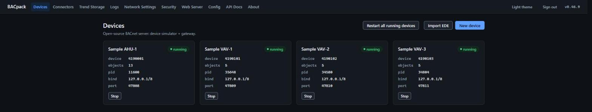

# BACpack

Simulated BACnet devices to test your BMS against. BACpack runs BACnet/IP devices on Linux or Windows, managed from a web UI. Copy a job's controllers on site or build them from the EDE file, then keep working without the hardware: values move, trends fill, schedules run and points alarm. It can also serve live values from an HTTP endpoint or another BACnet device as BACnet objects ([Using it as a gateway](#using-it-as-a-gateway)).

[Try it](#try-it) · [Install](#install) · [What it does](#what-it-does) · [Guide](docs/guide/README.md)



Current release: **`1.0.1`** (see [CHANGELOG.md](CHANGELOG.md)). [MIT licensed](LICENSE). Every device meets the B-BC profile. The About page lists each BIBB, and [PICS.md](PICS.md) is the conformance statement.

BACpack has no redundancy or high availability, so plan around that if you run it in a live building. Run it on a trusted network.

An AI coding assistant (Anthropic's Claude, through Claude Code) wrote almost all of the code, tests and documentation. The direction is human, from someone who has worked with BACnet in the field. Tests run on Windows and Linux, and live checks run against real BACnet clients. Judge it by that and by your own testing.

## Try it

[Getting started](docs/guide/getting-started.md) has the full version.

1. Install BACpack ([Linux or Windows](#install)).
2. Open `https://<host>:8000`.
3. Set the default bind address under **Network Settings**.
4. Click **Load sample building** on the Devices page.
5. Send a Who-Is on UDP 47808 from your tool.

To build your own, use **New device** or **Import EDE** on the Devices page, or copy a real controller ([Cloning a live controller](docs/guide/cloning-a-live-controller.md)).

## What it does

- Cloning: copy a live controller's objects, schedules, alarm settings and Trend Logs into a simulated device ([guide](docs/guide/cloning-a-live-controller.md)).
- EDE import: build devices from an EDE file ([guide](docs/guide/importing-an-ede-file.md)).
- Several devices at once, each with its own IP address and UDP port, answering while the web server restarts.
- Objects: Analog, Binary and Multi-state Input/Output/Value, Schedule, Calendar, Notification Class, Trend Log, Network Port and File. Outputs and Values are commandable.
- Services: Who-Is/I-Am, Who-Has/I-Have, ReadProperty(Multiple), WriteProperty(Multiple), COV, ReadRange, intrinsic alarming, Add/RemoveListElement, time synchronization, DeviceCommunicationControl, ReinitializeDevice, backup and restore, BBMD and foreign devices.
- Live edits: add, delete or change objects on a running device. Commanded values, alarm state and COV subscriptions survive.
- Driving values: simulators, and schedules that write objects on this or another device. A per-object **BACnet writable** switch locks Present_Value against wire writes.
- Connectors (optional): HTTP pull connectors, and BACnet connectors that read, write or proxy points on other devices.
- Watching: live values and priority arrays, traffic and log views, trend charts, and a BACnet client tab.
- Config as files: export and import all devices and connectors as JSON, or one device's objects as a CSV point list. Passwords, tokens and header values are never in the file. A connector's URL is, as typed, so keep credentials in its auth fields or headers.

[How BACpack compares](docs/comparison.md) with other BACnet device simulators.

## Using it as a gateway

An HTTP pull connector polls a JSON or text endpoint into objects. A BACnet connector reads points from another BACnet device, writes to them, or proxies them. In a live building:

- Try it on a bench first. Point a connector at a spare controller or a simulator, and check each mapping's last value and error on the Connectors page.
- Writes reach real equipment. Write and proxy mappings command the remote device at a priority. A proxy passes on a write from any BACnet client that reaches BACpack. Turn **BACnet writable** off on objects no client should change.
- When a source stops answering, a read mapping lets go of its value. A proxy keeps its last value and sets Reliability to communication failure. A clean stop releases what BACpack wrote to remote devices. A crash or power cut leaves it in place. Plan for that if something must keep running.
- Keep it on a trusted network. Anyone who reaches a device's UDP port can read and write it. Keep the login on, bind each device to the network that needs it, and open its ports no further. See [SECURITY.md](SECURITY.md).

## Install

BACpack installs as a service on Linux (systemd) and Windows. Run either installer again to upgrade. Remove either with `bacpack-admin uninstall`.

### Linux

You need systemd and Python 3.13 or newer with `venv` and SQLite 3.34 or newer. Download the release's source archive or clone the repository, then run from its folder:

```bash
sudo ./packaging/install.sh                 # web UI on port 8000
sudo ./packaging/install.sh --port 8080     # or another port
```

The installer checks everything first and changes nothing if a check fails. It installs into a virtualenv in `/opt/bacpack`, creates a `bacpack` system user that owns `/var/lib/bacpack`, starts `bacpack.service` and opens the web port and 47808/udp in firewalld or ufw if one is active. Logs: `journalctl -u bacpack -f`.

On RHEL 9 and its rebuilds (Rocky, Alma), run `sudo dnf install python3.14` first.

Upgrade: run the new release's `install.sh`. It keeps the port and Python. A service you stopped yourself stays stopped: start it with `sudo systemctl start bacpack`. See [Upgrading](docs/guide/upgrading.md).

Uninstall: `sudo bacpack-admin uninstall` keeps `/var/lib/bacpack`. Add `--purge` to delete it. See [Uninstalling](docs/guide/uninstalling.md).

### Windows

Setup wizard (recommended): download `BACpack-<version>-setup.exe` from the release and run it with administrator rights. It asks for the web UI port and when to create the login, and carries its own Python. The setup is not signed, so SmartScreen shows "Windows protected your PC". Choose **More info**, then **Run anyway**.

A newer setup upgrades the install and keeps its port, data and login. To remove BACpack, use Settings > Apps > Installed apps.

For a silent install, run `BACpack-<version>-setup.exe /VERYSILENT /SUPPRESSMSGBOXES /PORT=8000`. Add `/LOG=setup.log` to keep a log. A failed install ends with exit code 7.

Offline bundle (the zip, for scripted installs and Server Core): download `BACpack-<version>-windows-x64.zip` from the release and unzip it. In an elevated PowerShell in that folder, run:

```powershell
powershell -ExecutionPolicy Bypass -File install.ps1             # web UI on port 8000
powershell -ExecutionPolicy Bypass -File install.ps1 -Port 8080
```

From source: install Python 3.13 or newer for all users, then run `powershell -ExecutionPolicy Bypass -File packaging\install.ps1 [-Port N] [-Python C:\path\to\python.exe]` from the source archive or a clone. It downloads [WinSW](https://github.com/winsw/winsw) and checks its hash.

The service is named `BACpack` and runs as `NT SERVICE\BACpack`. Code is in `C:\Program Files\BACpack`, data and logs in `C:\ProgramData\BACpack`. The web port and 47808/udp are opened in the firewall rule group `BACpack`.

Upgrade: run the new release's `install.ps1`. A service you stopped yourself stays stopped: run `Start-Service BACpack`. See [Upgrading](docs/guide/upgrading.md).

Uninstall: from an elevated Command Prompt (in PowerShell put `&` in front), run `"C:\Program Files\BACpack\bacpack-admin.cmd" uninstall`. It keeps the data. Add `-Purge` to delete it. A setup install is removed from Installed apps instead. See [Uninstalling](docs/guide/uninstalling.md).

### Port 443

The web UI is HTTPS only, on the installer's port (8000 by default). For 443, run the installer again with that port.

- Linux: first create `/etc/systemd/system/bacpack.service.d/override.conf` containing `[Service]` and `AmbientCapabilities=CAP_NET_BIND_SERVICE`. Make the folder with `sudo mkdir -p /etc/systemd/system/bacpack.service.d`, which works before the service exists. Without this file the service user can't bind a port below 1024, and the installer refuses one. Then run `sudo ./packaging/install.sh --port 443`.
- Windows: run `install.ps1 -Port 443`. If another program holds 443 (IIS does when installed), the service fails to start and logs why.

### What happens to running devices

| You do | Devices |
|---|---|
| Stop the service (or `Ctrl+C` a hand-run server) | stop, and are remembered |
| Start the service | the remembered ones start again. One whose address isn't up yet is retried every 10 s for 5 minutes. |
| Restart the service, upgrade, reboot | stop, then come back |
| Power cut or forced reset | come back at the next start |
| The web process crashes | keep running, and are picked up when the service restarts it |
| **Restart UI only** (Dashboard, Network Settings) | keep running |

A device you stopped yourself stays stopped.

### First visit and administration

Open `https://<host>:8000`. The self-signed certificate made at first start makes the browser warn once. **Web Server** ([described here](docs/guide/web-ui-tour.md#web-server)) shows its SHA-256 fingerprint and takes your own certificate instead.

The first visitor claims the install by creating a login or running without one. For an unattended install, pass `--login-user NAME` (Linux) or `-LoginUser NAME` (Windows) with the password in the environment variable `BACPACK_LOGIN_PASSWORD`, never on the command line. Or pass `--no-login` / `-NoLogin`.

To reset a forgotten password, run `sudo bacpack-admin reset-login` (Linux) or `bacpack-admin.cmd reset-login` from an elevated prompt in `C:\Program Files\BACpack` (Windows). The same tool makes a new self-signed certificate (`web --self-signed`), sets the listen address (`web --address ADDR`, then restart the service) and shows the state (`status`).

[SECURITY.md](SECURITY.md) says what BACpack protects, what it does not, and the recommended setup.

Config is in `bacpack.db` and history in `bacpack-history.db` beside it. `BACPACK_DB_PATH` moves them.

## Using it

The [guide](docs/guide/README.md) has the walkthrough, task pages and references. [A tour of the web UI](docs/guide/web-ui-tour.md) says what each page does.

## Development setup

Plain HTTP, for development only. The installed service serves HTTPS only.

```powershell
python -m venv .venv
.\.venv\Scripts\python.exe -m pip install -c packaging/constraints.txt -e ".[dev]"
.\.venv\Scripts\python.exe -m uvicorn bacpack.web.app:app --host 0.0.0.0 --port 8000
```

The UI is a React app in `frontend/`, built into `src/bacpack/web/spa/` and committed, so running BACpack needs no Node.js. See `frontend/README.md` for `npm run dev`, `npm run build` and `npm run test`. Rebuild and commit `src/bacpack/web/spa/` whenever a `frontend/` change should ship.

### Tests

```powershell
.\.venv\Scripts\python.exe -m pytest
```

## Changelog

[CHANGELOG.md](CHANGELOG.md) has the release history and [ROADMAP.md](ROADMAP.md) the plans after 1.0. [MAINTENANCE.md](MAINTENANCE.md) says what to expect from releases and issues. [CONTRIBUTING.md](CONTRIBUTING.md) covers sending a change, and [docs/architecture.md](docs/architecture.md) covers how it is put together.
