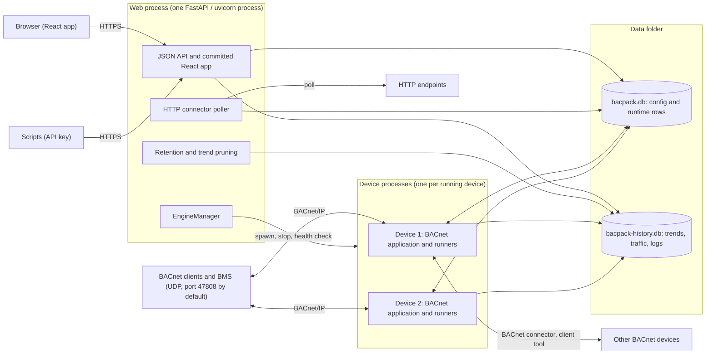

# How BACpack is put together

See [CONTRIBUTING.md](../CONTRIBUTING.md) for contributing and the [README](../README.md) for what BACpack does. Paths below are under `src/bacpack/` unless they start with another folder.

## 1. Overview

The web process and the device processes share no memory and send no messages. They coordinate only through the two SQLite files.

## 2. Process model

### One web process

`python -m bacpack serve` (or `uvicorn bacpack.web.app:app` in development) runs one FastAPI/uvicorn process on one asyncio loop. It owns the `EngineManager` (`engine.py`) that starts and stops devices.

### One OS process per running device

Each running device is its own process with its own bacpypes3 `Application`, bound to its own IP address and UDP port.

`EngineManager` starts it with `multiprocessing`'s `spawn` method (`fork` would copy the web server's listening socket) and `daemon=False`, so a device keeps answering while the web process restarts or crashes.

### What a child does

`device_process.py` holds a child's whole life. `run_device_process` takes only a database path string and a device id, since `spawn` cannot carry a live engine or session.

`_serve_device` loads the device's rows, builds the BACnet application (section 4) and starts the runners (trends, simulators, BACnet connectors, external schedule writes, client tool requests, queued writes). It marks the row `running` and serves until the row says `stopping` or `reinitializing`, is gone, or names another process, then marks itself `stopped`.

### Coordination is SQLite only

Each device has one `device_runtime` row in `bacpack.db` (status, process id, start time, the counters in section 4). A child reads its own row once a second (`device_watch.py`). The parent reports status from the same rows, not from its in-memory process table.

Work for a child is queued in rows: a manual or feed write on the object's `object_runtime` row, a client tool request in `client_requests`. A child never runs schema migrations: the web process runs `init_db` (section 3) first.

### Health check and reattach

The parent checks its children every few seconds (`HEALTH_CHECK_INTERVAL_SECONDS`) and marks a dead one `crashed`. At startup `reattach_running_devices` checks every row claiming a live child.

Pids get reused, so the parent accepts one only if the process's `psutil` creation time still matches the recorded start time (`_is_same_process`). On Linux it also accepts a match on the start time counted from boot with the same boot id (`process_identity.py`), since an NTP step moves creation times. Anything else is treated as gone.

### Stop and resume

A requested stop of the web process (service stop, SIGTERM, Ctrl+C) stops every device and remembers the running ones. The next start restarts them (`resume_remembered_devices`), retrying a device whose address isn't up yet every 10 s for 5 minutes. A crash of the web process stops nothing.

## 3. Data

Two SQLite files sit in the data folder (`./data/` from source, moved by `BACPACK_DB_PATH`).

| File | Holds |
|---|---|
| `bacpack.db` | Configuration the UI edits and that survives a restart: devices, objects, connectors and mappings, settings (login, listen address, retention), sessions, API keys. Also one runtime row per owner: `device_runtime` (process tracking, change counters, a pending clock change), `object_runtime` (queued writes, an external schedule's status), `connector_runtime` (a BACnet connector's status). |
| `bacpack-history.db` | Recorded history: trend samples, traffic log, application log, client requests, and the counters for them. |

`db.make_engine` attaches the history file to every connection as schema `history`.

A save that writes both files calls `db.lock_both_files(session)` first. Without it, a read-then-write across files fails at once with "database is locked" when another process holds the lock.

### What persists

Config persists. Present values and priority arrays do not: they are built from config at process start and never saved.

### Time

Stored timestamps are naive UTC. Every conversion (host time, API strings, BACnet Date and Time) goes through `timeutil.py`.

`device_clock.py` is each device's own clock, host time plus an offset, which schedules, calendars and alarm time stamps follow.

### Migrations

`migrations.py` is hand-rolled. `init_db` runs two mechanisms at every start:

- An explicit, numbered list per file (`MIGRATIONS`, `HISTORY_MIGRATIONS`), tracked by SQLite's `PRAGMA user_version`.
- `add_missing_columns`, which adds any column a model declares and the table lacks.

The lists are append-only. A file saved by a newer BACpack is refused with `DatabaseTooNew` before anything changes.

### Secrets

Connector passwords, tokens and header values are stored encrypted (`secrets_store.py`), with the key in `secret.key` in the data folder.

## 4. BACnet layer

`object_builder.py` turns a device's rows into live bacpypes3 objects: `build_bacnet_object` builds one, `OBJECT_CLASSES` maps each type to its class, and `build_application` assembles a `LoggingApplication` (`application.py`).

`LoggingApplication` is the bacpypes3 `Application` subclass. It holds the customized service handlers: Who-Is and I-Am, ReadProperty and ReadPropertyMultiple, WritePropertyMultiple, COV, ReadRange, Add and RemoveListElement, time synchronization, alarm acknowledgement and GetEventInformation, ReinitializeDevice, DeviceCommunicationControl, and the file reads and writes that carry backup and restore.

Per-type behavior is under `objects/`.

### Validation

`object_config.py`'s `check_object(row)` and `check_device(device_name, rows)` alone decide whether an object can be built. Every save path and the build call them on the row as it will be.

### The bacpypes3 boundary

BACpack reaches bacpypes3 internals only through `bacpypes3_compat.py`. `OVERRIDES` lists every upstream method a BACpack class replaces. `DEPENDS_ON` lists every upstream internal a helper relies on. `tests/test_bacpypes3_compat.py` fails on an upgrade, a new override or a reach-in elsewhere.

### Live edits

An edit reaches a running device without a restart:

1. SQLite triggers (`TRIGGERS` in `migrations.py`) bump counters on the device's `device_runtime` row: `change_seq` for any change or queued write, `config_seq` for config changes only.
2. Each second `DeviceWatch` reads that row. If `config_seq` moved, `live_config.py`'s `ObjectReloader` reloads the rows, checks them with `check_device`, rebuilds only the changed objects and swaps them in (`live_swap.py`) in one synchronous step. The runners reload.
3. If only a write was queued, `PendingWritePoller` applies it without a reload.

A change that can't be applied live (name, vendor, bind address) shows as a pending restart.

### Writes into the priority array

Two fixed priorities (`bacnet.py`):

- `FEED_PRIORITY` (10): simulators, HTTP connectors, BACnet read mappings and `POST /api/feed`.
- `MANUAL_PRIORITY` (8): `POST /api/manual`.

## 5. Connectors and simulators

Simulators, HTTP connectors and BACnet read mappings write at the feed priority (10), so a higher-priority client write wins. An Input has no priority array: the feed sets its Present_Value, only while it is not out of service.

- Value simulators: `simulation.py` and `simulation_runner.py`, one runner per device process.
- HTTP pull connectors (`connectors.py`): one `ConnectorPoller` in the web process polls each enabled connector and writes the extracted fields to mapped objects on any device. The poller queues each value on the object's `object_runtime` row for the device process to apply.
- BACnet connectors (`bacnet_connectors.py`, `bacnet_connector_relinquish.py`, `bacnet_connector_proxy.py`): these run inside the owning device's process, using its BACnet client (`bacnet_client.py`). A read mapping feeds a local object at the feed priority and relinquishes on failure. A write mapping sends a local object's value to the remote device.
- Proxy mappings (`bacnet_proxy.py`): mirror a remote point's Present_Value and Priority_Array into a local commandable object and pass local writes through.
- Schedules: a Schedule writes its targets at its own priority (`priorityForWriting`). `schedule_external.py` sends a target on another device through the same client, retrying until the remote holds the value.
- The web UI's BACnet tool: the web process never sends BACnet itself. A route inserts a `client_requests` row, and the chosen device's `ClientRequestPoller` sends it from that device's address and writes the answer back.
- Trends: `trending.py` samples objects in the device process, at an interval or on COV, into `TrendSample` rows in the history file. The web process prunes them.

## 6. Web layer

### App and login

`web/app.py`'s `create_app()` builds the FastAPI app. Its lifespan checks the SQLite version, runs `init_db`, creates the `EngineManager`, connector poller and pruning tasks, and reattaches devices.

`web/auth_middleware.py` wraps every request: session cookie or API key, first-use setup gate, login lockout, cross-site check. The session cookie is always `Secure` under `serve`.

### The API

`web/api/` has one router module per feature area. `web/api/__init__.py` mounts them all under `/api` from one tuple, `_MODULES`, in a fixed order. A literal route such as `.../objects/export.csv` precedes the `.../objects/{object_id}` routes.

A new feature gets its own router module and one `_MODULES` entry. Routers don't import each other. Shared code lives in `_lookups.py`, `_serializers.py`, `_object_validation.py` and the other underscore-named modules, and models in `web/schemas.py`.

The schema is at `/openapi.json`, registered before the catch-all below. The Swagger UI page at `/docs` is part of the React app.

### The React app

`frontend/` holds the source (Vite, React, TypeScript). `npm run build` writes into `src/bacpack/web/spa/`, which is committed and shipped as package data.

`/assets` is a static mount. Everything else outside `/api` returns `index.html`. An unmatched path under `/api/` returns a real 404.

### `python -m bacpack serve`

`serve.py` is what both services run, HTTPS only. It reads the listen address from settings, waits up to 120 s for a saved address that isn't on the machine yet, loads the certificate and key from `<data folder>/tls/` (`cert.pem`, `key.pem`; `tls_certs.py` makes a self-signed pair at the first start), sets the `BACPACK_HTTPS` and `BACPACK_RUNNING_*` markers (`lifecycle.py`) and starts uvicorn in the same process. `--port N` or `BACPACK_PORT` sets the port (default 8000). Exit codes are in section 7.

`python -m bacpack.admin` works on the files directly for local recovery (reset the login, make a certificate, set the listen address, show status). The installers add it as `bacpack-admin` (Linux) and `bacpack-admin.cmd` (Windows).

## 7. Services and install

| | Linux | Windows |
|---|---|---|
| Service | systemd unit `bacpack.service` (`packaging/bacpack.service`) | Windows service `BACpack`, wrapped by WinSW (`packaging/windows/bacpack-service.xml.template`) |
| Runs as | system user `bacpack` | `NT SERVICE\BACpack` |
| Code | `/opt/bacpack` (own virtualenv) | `C:\Program Files\BACpack` |
| Data | `/var/lib/bacpack` | `C:\ProgramData\BACpack` |
| Installer | `packaging/install.sh` | `packaging/install.ps1` |
| Command run | `python -P -m bacpack serve --port N` | the same |

Both installers use `packaging/constraints.txt`, can be run again to upgrade, and take an uninstall option. The Windows release is an offline bundle with its own Python (`packaging/windows/build_bundle.ps1`) and a setup wizard, `BACpack-<version>-setup.exe` (`packaging/windows/bacpack.iss`), which runs the bundle's `install.ps1`.

### Devices outlive the web process

The systemd unit sets `KillMode=process`, so stopping or crashing the web process does not kill devices. A requested stop stops them within `TimeoutStopSec=90`. WinSW's stop timeout is 90 s too.

### What restarts and what doesn't

The web process exits with a code defined in `lifecycle.py`:

| Code | Meaning | Restarted? |
|---|---|---|
| 75 | Restart the web UI only (`RESTART_UI_EXIT_CODE`) | yes, devices keep running |
| 78 | SQLite too old for BACpack | no |
| 79 | Certificate and key pair unusable | no |
| 80 | Saved listen address not on this machine after 120 s | yes, every 5 s |
| 81 | Database saved by a newer BACpack (`DatabaseTooNew`) | no |

The no-retry codes are `lifecycle.NOT_RETRIED_EXIT_CODES`, which systemd's `RestartPreventExitStatus=78 79 81` follows. A new exit code that a restart cannot fix joins that tuple.

WinSW 2.12 restarts on every non-zero exit and hangs on an exit of 0 under the virtual account, so on Windows the process asks for its own service to be stopped (`windows_service.py`) and waits for WinSW's stop signal (`serve._service_exit_code`). See `packaging/windows/README.md`.

## 8. Where to start reading

| To look at | Start in |
|---|---|
| How a device starts, runs and stops | `device_process.py`, `engine.py` |
| How edits reach a running device | `device_watch.py`, `live_config.py`, the `TRIGGERS` in `migrations.py` |
| How a row becomes a BACnet object | `object_builder.py`, `objects/` |
| BACnet services and their quirks | `application.py`, `bacnet.py`, `bacpypes3_compat.py` |
| What makes an object valid | `object_config.py`, `point_config.py` |
| The database | `models.py`, `db.py`, `migrations.py` |
| Trends and history | `trending.py`, `history_writer.py`, `trend_range.py` |
| Connectors | `connectors.py`, `bacnet_connectors.py`, `config_connectors.py` |
| Simulators | `simulation.py`, `simulation_runner.py` |
| The web app and API | `web/app.py`, `web/auth_middleware.py`, `web/api/` |
| Starting as a service | `serve.py`, `lifecycle.py`, `web_server.py`, `tls_certs.py`, `packaging/` |
| Config import and export, CSV, backups | `config_io.py`, `csv_io.py`, `ede_io.py`, `backup_restore.py` |
| The web UI | `frontend/src/` |
| The conformance statement | `pics.py`, `scripts/make_pics.py`, `PICS.md` |
